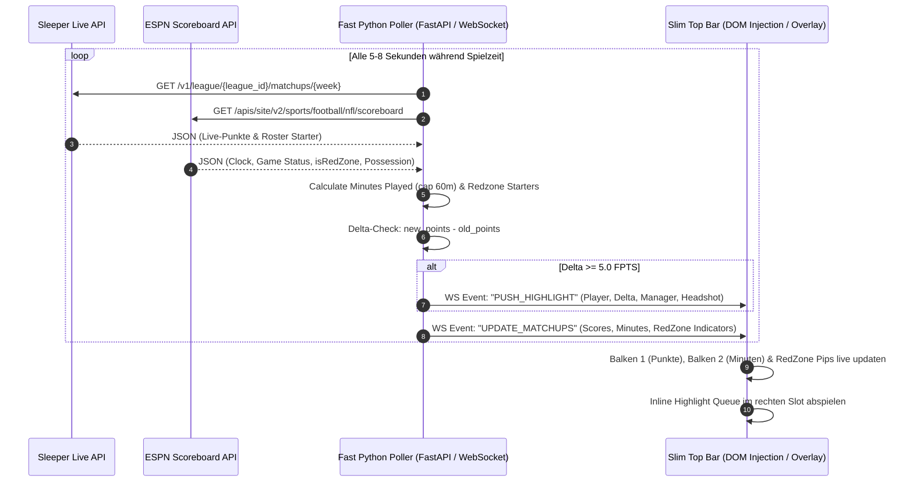

# 🎮 NFL Fantasy Live Game HUD — Ultra-Slim Top Bar Konzept

Ein minimalistisches, broadcast-taugliches Stream-Overlay (**OBS Browser Source / Web Overlay / Floating Window**), das als **einziges schlankes horizontales Band (68px) am oberen Bildschirmrand** über dem Livestream liegt. Das eigentliche Videobild darunter bleibt zu **100% frei und unverdeckt**.

---

## 🖥️ 1. Screen Layout & Visual Hierarchy

Das gesamte Overlay beschränkt sich auf einen **64px – 72px hohen Streifen am oberen Rand** des 16:9 Streams (1920x1080).

```
+-------------------------------------------------------------------------------------------------------+
| [ ULTRA-SLIM TOP BAR (Höhe: 68px) | background: rgba(10,15,29,0.92) blur(10px) ]                      |
|                                                                                                       |
|  +---------------------+  +---------------------+  +---------------------+  +----------------------+  |
|  | MATCHUP 1 (24%)     |  | MATCHUP 2 (24%)     |  | MATCHUP 3 (24%)     |  | 🔥 HIGHLIGHT QUEUE   |  |
|  | Team A   94.2 [====]|  | Team C   82.1 [=== ]|  | Team E  104.5 [====]|  | [Avatar] J. Allen    |  |
|  | Team B   88.4 [=== ]|  | Team D   79.0 [==  ]|  | Team F  112.3 [=====|  | +6.4 FPTS TD (wetsch)|  |
|  | ⏱ 75% Time Played   |  | ⏱ 40% Time Played   |  | ⏱ 90% Time Played   |  | (Queue: 1/3 • 6s)    |  |
|  +---------------------+  +---------------------+  +---------------------+  +----------------------+  |
+-------------------------------------------------------------------------------------------------------+
|                                                                                                       |
|                                                                                                       |
|                               ( 100% FREIES LIVESTREAM VIDEOBILD )                                   |
|                                                                                                       |
|                                                                                                       |
+-------------------------------------------------------------------------------------------------------+
```

---

## 💡 2. Wie liegt die Leiste über dem Vollbild-Stream? (3 praktische Methoden)

Je nachdem, wie du den NFL-Stream schaust (im Browser, via OBS oder auf dem Mac/PC), gibt es 3 clevere Wege, die Leiste über den Vollbild-Stream zu legen:

---

### 🌟 Methode 1 (Beste & Einfachste für Browser-Streams): Direct Browser Injection (Tampermonkey / Bookmarklet)
Wenn du den Stream im Browser schaust (z. B. **NFL Game Pass (DAZN), RTL+, YouTube TV, NFL.com**):
* Ein winziges Skript (oder Bookmarklet / Tampermonkey-Erweiterung) injiziert die 68px Top-Bar direkt in den DOM-Baum der Streaming-Webseite oberhalb des `<video>`-Players.
* **Der Vorteil**: Wenn du den Stream auf **Vollbild** klickst, ist die Leiste **automatisch Teil des Vollbild-Videos**!
* Keine extra Software nötig, funktioniert in Safari, Chrome, Brave und Edge.

---

### 🪟 Methode 2: Native macOS App ("Ghost"-Overlay mit Apple Silicon & WebKit)
Wenn du den Stream über eine separate App oder einen beliebigen Video-Player schaust:
* Die native Swift App (`NFL Fantasy HUD.app`) öffnet ein rahmenloses, transparentes Floating Panel am oberen Bildschirmrand:
  - **Always-on-Top Floating Panel** (Level `.screenSaver`): Schwebt dauerhaft über jedem Vollbild-Stream (auch über anderen Spaces & Vollbild-Apps).
  - **100% Click-Through & Intelligente Hover-Transparenz**:
    - Maus- und Klick-Events gehen nahtlos durch (`ignoresMouseEvents`), sodass Browser-Tabs und Video-Player darunter uneingeschränkt klickbar sind.
    - **Ultra-Fade bei Cursor-Hover**: Befindet sich der Mauszeiger im oberen HUD-Bereich, blendet sich das Overlay automatisch sanft auf **8% Deckkraft (0.08 Alpha / 92% transparent)** ab. Man sieht Browser-Tabs, Adresszeile und Menüs darunter glasklar und kann sie direkt bedienen, ohne das HUD per `Cmd+H` ausschalten zu müssen. Verlässt die Maus den oberen Bereich, kehrt das HUD sofort zu 100% Opacity zurück.
  - **Multi-Monitor & Beamer Support**: Live-Auswahl des Ziel-Bildschirms (z. B. Beamer, externer TV, AirPlay-Display oder MacBook-Display) im Setup-Dialog und jederzeit per Menüleiste (`🖥️ Target Display`).
  - **Automatischer Installations-Sync**: `./build_mac_app.sh` aktualisiert automatisch bestehende Installationen in `/Applications/NFL Fantasy HUD.app`, sodass im Dock verknüpfte Apps stets auf dem exakt selben, neuesten Stand sind.
  - **Shortcuts & Audio-Steuerung**: **`Cmd+M`** schaltet Highlight-Sound-Effekte um, **`Cmd+H`** blendet das Overlay ein/aus (und dockt es neu an den Monitor an), **`Cmd+S`** öffnet den Setup-Dialog.
  - **Build-Kommando**: `./build_mac_app.sh` kompiliert die native Apple Silicon App direkt und signiert das Bundle ad-hoc.

#### 📐 Technische Vertiefung: Multi-Monitor & AirPlay / Beamer Geometrie
Beim Betrieb mit externen Displays (wie Beamern oder AirPlay-Empfängern) ordnet macOS Monitore in einem **globalen Koordinatensystem** an:
* Das Hauptdisplay (MacBook Retina) liegt bei `(x: 0, y: 0, w: 1512, h: 982)`.
* Das Beamer-/AirPlay-Display liegt rechts daneben mit globalen Koordinaten, z. B. `(x: 1512, y: -98, w: 1920, h: 1080)`.
* **Behobenes Koordinaten-Phänomen**: Übergibt man bei der Initialisierung von `NSWindow(contentRect:styleMask:backing:defer:screen:)` sowohl globale Koordinaten (`x = 1512`) als auch das Ziel-Screen-Objekt `screen: targetScreen`, interpretiert AppKit das `contentRect` relativ zum Ursprung des Zielmonitors. Die Monitorkoordinate wurde dadurch doppelt addiert (`1512 + 1512 = 3024`), wodurch das Fenster um 1512 Pixel nach rechts ins Aus geschoben wurde und auf dem Beamer nur die ersten ~400 Pixel (`[WK 3]` und das erste Matchup) am rechten Bildschirmrand sichtbar waren.
* **Architektur-Lösung**: Das Overlay-Panel wird mit globalen AppKit-Koordinaten ohne relatives Screen-Offset initialisiert und via `window.setFrame(windowRect)` exakt auf den Zielmonitor gesetzt. Beim Neuverbinden von AirPlay wird der Bildschirm automatisch anhand seines Namens (`localizedName`) wiedererkannt und die innere WebKit-Viewport-Größe (`webView.frame`) synchron aktualisiert.

#### 🚀 Performance- & AirPlay-Optimierung: Stotterfreies Streaming auf Beamer / Apple TV
Bei der drahtlosen Übertragung des Bildschirms via **AirPlay** auf einen Beamer oder ein Apple TV kam es zuvor zu wiederkehrenden Mikrorucklern im Videobild. Die Ursachenanalyse und technische Lösung im Detail:
1. **Reduzierung der Overlay-Fensterfläche um ~93% (78px Top-Band statt 1080px Vollbild)**:
   - *Problem*: Zuvor spannte die native App ein transparentes 1920×1080 Pixel großes Fenster über den gesamten Bildschirm auf. macOS WindowServer musste dadurch bei jedem einzelnen Frame (60 Hz) alle 2.073.600 Pixel per GPU alpha-blenden, was hardwarebeschleunigtes Direct Scanout und Zero-Copy AirPlay Video-Encoding blockierte.
   - *Lösung*: Das native AppKit-Fenster und die innere WebKit-View sind nun exakt auf die 78 Pixel des oberen Balkens (`y = screenRect.maxY - 78`, `h = 78`) beschränkt. Die restlichen **~93% des Beamer-Bildschirms** (1002 von 1080 Pixeln) sind vollkommen fensterfrei. macOS encodiert den darunterlaufenden Videostream direkt per Hardware ohne GPU-Compositor-Overhead.
2. **Eliminierung des zyklischen 2.0s Polling-Timers**:
   - *Problem*: Ein Hintergrundtimer rief alle 2.0 Sekunden `window.orderFrontRegardless()` auf. Jeder dieser Aufrufe unterbrach den macOS WindowServer-Compositor und erzeugte einen rhythmischen Frame-Drop im AirPlay-Stream.
   - *Lösung*: Der Timer wurde vollständig entfernt. Das Fenster bleibt rein event-basiert über das Window-Level `.screenSaver` sowie die Observer `activeSpaceDidChangeNotification` und `didActivateApplicationNotification` im Vordergrund – vollkommen ohne Stream-Unterbrechungen.
3. **In-Bar Toast-Positionierung**:
   - Toasts und Benachrichtigungen werden direkt innerhalb des 78px Top-Bands gerendert, wodurch keine Elemente außerhalb des optimierten Fensters abgeschnitten werden.

---

### 🎥 Methode 3: OBS Studio (für Livestreams / Streaming-Setups)
Wenn du den Stream über OBS Studio capturest oder streamst:
* Lege in OBS eine **Browser Source** an:
  - **URL**: `http://homebridge.local:8080/overlay` (oder `http://192.168.188.147:8080/overlay`)
  - **Breite**: `1920`, **Höhe**: `1080`
* Setze die Browser Source in der Szenenliste über deine Videoquelle. Fertig!

---

## 📊 3. Detaillierte Komponenten-Spezifikation (Alles im Top-Band)

### A. League Matchup Kacheln (Links & Mitte, ca. 75% Gesamtbreite)
Jedes Matchup der Liga hat seine eigene kompakte Kachel mit folgenden Elementen:

1. **Manager & Punktestände**:
   - Manager-Avatar mit Neon-Glow-Border in der Manager-Akzentfarbe.
   - Live-Punkte in fetter Typografie (`104.2 - 98.6`), mit Führend-Highlighting (`.leading`) und Score-Flash-Animation bei Punktegewinnen.
2. **Dual Progress Bars (Zwei Balken untereinander im Matchup)**:
   - **Balken 1: Punkteverteilung (Score Ratio — Hauptfokus)**:
     - Zeigt das Verhältnis der erzielten Fantasy-Punkte zwischen Team A (links) und Team B (rechts).
     - Hauptaugenmerk der Kachel: Kräftige, leuchtende Farben der beiden Manager mit Glow-Schatten (Höhe: 3.5px).
   - **Balken 2: Gespielte Spielminuten (Minutes Played Bar — Beamer-optimiertes Silber-Grau)**:
     - Gestaltet in hellem, klarem Silber-Grau (`#cbd5e1`, 0.95 Opacity, Höhe: 2.5px) mit dezentem silbernem Kontrast-Schein (`rgba(203, 213, 225, 0.4)`), perfekt lesbar auf Beamern und Projektoren, ohne mit den bunten Managerfarben der Score-Bar zu konkurrieren.
     - Beide Balken starten bei 0% an den jeweiligen Außenrändern (Team A am linken Rand, Team B am rechten Rand).
     - Team A wächst nach rechts (Richtung 50% Mitte), Team B wächst nach links (Richtung 50% Mitte).
     - Bei 100% absolvierter Spielzeit (alle 9 Starter haben 60 Minuten gespielt = 540 Gesamt-Spielminuten pro Team) treffen sich die beiden Balken exakt an der 1px-Mittellinie bei 50%.
     - Overtime wird ignoriert (Deckelung auf max. 60.0 Min pro Spieler).
     - Verhindert Fehlinterpretationen bei Führungen (z. B. wenn Team A führt, aber Team B noch 4 Starter im Spätspiel hat).
3. **Red Zone Alert (Avatar Pips — Bleibt aktiv bis Drive-Ende & großzügiger Abstand)**:
   - Befindet sich mindestens ein offensiver Starter eines Fantasy-Teams (QB, RB, WR, TE, K, FLEX) aktuell in der gegnerischen Redzone (Ballbesitz an/innerhalb der 20-Yard-Linie des Gegners):
     - **Großzügiger Avatar-Abstand**: 10px Gap + 2px Margin verhindern jegliches Gedränge zum Avatar-Glow-Border und geben den Dots einen sauberen, aufgeräumten Look.
     - **1 Spieler**: 1 leuchtender Punkt (`.rz-dot`) in der zugehörigen Fantasy-Manager-Farbe neben dem Avatar.
     - **2 Spieler**: 2 leuchtende Punkte.
     - **3 Spieler**: 3 leuchtende Punkte.
     - **4+ Spieler**: Ein kompaktes, pulsierendes `3+` Badge (`.rz-badge-more`) in der Managerfarbe (`@keyframes rz-dot-pulse`).
     - **Dauer**: Bleibt so lange sichtbar, wie das Team im Ballbesitz in der Red Zone ist (im Live-Betrieb bis Drive-Ende; im Admin Dashboard persistent gespeichert, bis die Punkte geändert oder per Reset zurückgesetzt werden).
     - **0 Spieler**: Unsichtbar/ausgeblendet.
4. **NFL IRL Trades & In-Season Wechsel (24h Auto-Sync)**:
   - Die Sleeper-Spieler-Datenbank besitzt eine 24-Stunden-Gültigkeit (`CACHE_TTL_SECONDS = 86400`).
   - Spielerwechsel, NFL Trades und Free-Agent-Signings in der echten NFL werden automatisch mindestens einmal alle 24h synchronisiert.
   - Garantiert, dass die Red-Zone- und Minuten-Berechnungen immer das aktuelle echte NFL-Team des Spielers berücksichtigen.
   - Manueller Sofort-Sync im Admin Dashboard jederzeit per Klick möglich.

---

### B. Inline Highlight Queue Segment (Rechts außen, ca. 25% Gesamtbreite) & Prominente Alerts
Das Highlight-Segment ist **nahtlos in das rechte Ende der oberen Leiste integriert** und ragt **nicht** nach unten ins Videobild hinein.

* **Trigger**: Sobald ein Spieler in einem Play oder Drive **$\ge 5.0$ Fantasy-Punkte** erzielt (z. B. Pass-TD, Big Run, Interception Return).
* **Prominente Visuals & Jiggle-Effekt**:
  - **Entrance Pop & Jiggle** (`@keyframes highlight-entrance-jiggle`): Die Highlight-Box federt mit einem dynamischen Wobble/Jiggle (-2.2° / +2.2°) ein, um sofort ins Auge zu springen, ohne das Spielgeschehen zu verdecken.
  - **Re-Jiggle Burst** (`@keyframes highlight-jiggle-burst`): Kommt ein neues Big Play in die Queue während bereits ein Highlight läuft, reagiert die aktive Kachel mit einem erneuten Ruckeln.
  - **Metallic Light Sheen Sweep**: Ein animierter Glanzstreifen gleitet diagonal über die Highlight-Kachel.
  - **Pulsing Neon Outer Flare**: Verstärkter Neonschein passend zur Teamfarbe des Managers.
  - **Aktions-spezifische Emojis & Labels**:
    - 🏈 **Touchdown** (`🏈 TOUCHDOWN`): Nur echte Touchdowns (Pass, Rush, Receiving oder Defensive TD) erhalten das Football-Icon und das Label `TOUCHDOWN`.
    - ⚡ **Big Play** (`⚡ BIG PLAY`): Große Raumgewinne ohne TD (z. B. 45-Yard-Deep-Catch, langer Breakaway-Run) werden als `BIG PLAY` mit dem Blitz-Icon ausgezeichnet.
    - 🎯 **Field Goal** (`🎯 FIELD GOAL`): Weite Kicks und Field Goals ($\ge 5.0$ FPTS) tragen die Zielscheibe und das Label `FIELD GOAL`.
    - 🛡️ **Defense Stop** (`🛡️ DEF STOP`): Wichtige Turnover, Fumble Recoveries oder Safeties ohne TD werden mit dem Schild-Icon als `DEF STOP` markiert.
  - **Zusätzliches Flammen-Icon bei Monster-Plays ($\ge 10.0$ FPTS)**: Erzielt eine Einzelaktion 10 oder mehr Fantasy-Punkte (z. B. 75-Yard-TD-Bombe oder 80-Yard-Monster-Run), wird automatisch ein zusätzliches Flammen-Icon (`🔥`) hinzugefügt (z. B. `🏈🔥 TOUCHDOWN` bzw. `⚡🔥 BIG PLAY`).
  - **Fokus auf Spielzug & kein abgeschnittener Manager-Name**: Auf die Anzeige des Fantasy-Teamnamens im Highlight-Tag wird verzichtet. Die Team-Zugehörigkeit wird bereits zu 100% intuitiv über den Farbcode der Kachel transportiert.
  - **Authentischer NFL Broadcast Sound FX**:
    - Fanfaren-Akkorde (G4, C5, E5, C-Dur Akkord mit Obertönen), Sub-Bass Stadion-Kick-Impact und Glockenspiel-Sparkle Chime.
    - Ausgeliefert als hochauflösendes Broadcast-Audio (`/static/sounds/nfl_highlight.wav`) mit latenzfreiem Web Audio API Synthesizer Fallback.
  - **Clean Stream Overlay & Sound-Steuerung im Welcome Dialogue**:
    - **Ultra-Clean Top Bar**: Das Overlay verzichtet auf störende Lautsprecher-Buttons im Live-Stream, um ein 100% broadcast-reifes Aussehen zu garantieren.
    - **Welcome & Setup Dialog**: Sound wird komfortabel vor dem Start im macOS Welcome Dialogue per Checkbox aktiviert/deaktiviert (`[x] Enable Highlight Audio FX on Big Plays`).
    - **Auswahl aus 4 NFL Sound Themes**: Der Nutzer kann im Setup Dialogue und Dashboard direkt zwischen 4 authentischen Broadcast-Sounds wählen (`fox_horn`, `redzone`, `td_siren`, `brass_fanfare`).
    - **Tastatur & Menü Shortcuts**: Schnelles Stummschalten/Entstummen jederzeit per **`M`** (Browser) bzw. **`Cmd+M`** (macOS App).
    - **Dynamischer Farb-Rahmen**: Der Rahmen um die erzielten Punkte (`+8.0 FPTS`) passt sich exakt der Manager-/Teamfarbe an.
    - **Reines Weiß für alle Highlight-Texte (Beamer-Optimierung)**: Sämtliche relevanten Texte in der Highlight-Kachel werden in reinem Weiß (`#ffffff`) dargestellt für optimale Lesbarkeit auf Beamern.
* **Intelligente FIFO Queue-Logik (First-In, First-Out)**:
  - Scoren mehrere Spieler gleichzeitig (z. B. in der 19:00 Uhr Konferenz), reihen sie sich in die Queue ein (`+1 IN QUEUE`).
  - Anzeigedauer gekoppelt an die globale Animations-Geschwindigkeit (Normal: 10s, Fast: 5s, Slow: 20s).
* **Idle-Zustand (wenn keine Queue aktiv ist)**:
  - **All Active Players Rotation (Starters & Bench)**: Rotiert automatisch durch alle aktiven Spieler aller Fantasy-Manager der Liga (inklusive Bank-Spieler).
  - **Strikter Ausschluss von 0.0 FPTS & IR-Spielern**: Es werden in den MVP-/Spieler-Kacheln ausnahmslos nur Spieler angezeigt, die mehr als 0.0 FPTS erzielt haben.
  - **Positionsweise Rotation**: Die Rotation durchläuft strukturiert Position für Position (**QB → RB → WR → TE → K → DEF**).
  - **Minimalistisches Leader- & Kachel-Format**: Kronen-Emoji (`👑`) ausschließlich für den jeweiligen Positionsleader (`#1`).

---

### C. Live Test UI & Simulation Center (`/admin`)
Für Entwicklungs-, Präsentations- und Testzwecke steht unter `http://localhost:8080/admin` eine vollständige Test- und Simulationszentrale zur Verfügung:
* **Highlight Play & Sound Simulation Station**:
  - 1-Klick Presets für Big Plays (Josh Allen TD, Bijan Robinson Big Play, Aubrey FG, Vikings Pick-6, Free Agent).
  - 3-Play Queue Burst zur Simulation schneller Spielzug-Abfolgen.
  - Interaktive In-Browser Sandbox Preview mit Jiggle- und Sound-Tester.
* **Red Zone Alert & Dual Progress Bars Station**:
  - Matchup- & Team-Auswahl (Team A / Team B).
  - Live Red Zone Steuerung (0 Off, 1 Dot, 2 Dots, 3 Dots, 3+ Badge).
  - Spielzeit-Steuerung (0m, 135m / 25%, 270m / 50%, 405m / 75%, 540m / 100% Treffpunkt in der Mitte).
* **Sleeper Player Cache & NFL Trade Sync Card**:
  - Zeigt Cache-Alter in Stunden, Spieleranzahl und Freshness-Status (`FRESH` / `STALE`).
  - 1-Klick Button `Sync Roster / Trade Database Now` zum manuellen Abrufen aller aktuellen NFL-Kader.
* **Active Players Live Overview**:
  - Übersicht aller aktiven Liga-Spieler (Starters & Bench) nach Position geordnet und nach FPTS absteigend sortiert.
  - Interaktive Filterleiste nach Position (`ALL`, `QB`, `RB`, `WR`, `TE`, `K`, `DEF`) und Slot (`ALL`, `STARTER`, `BENCH`).

---

## ⚡ 4. Datenfluss & Technische Architektur



---

## 🌐 5. 100% Liga-Agnostische Architektur (Universal League Scalability)

Die gesamte HUD-Architektur ist vollständig **liga-agnostisch** konzipiert und skaliert automatisch für jede Sleeper-Liga – unabhängig von Team-Anzahl, Roster-Größe oder Starter-Zusammensetzung:

1. **Beliebige Team-Anzahl (8, 10, 12, 14, 16+ Teams)**:
   - Die API fragt dynamisch alle Matchups der jeweiligen Liga ab (`matchups = sleeper.get_matchups(...)`).
   - **Automatisches Layout**:
     - $\le 3$ Matchups (z. B. kleine Ligen oder Playoff-Wochen): **Statisches Layout**, alle Kacheln nebeneinander.
     - $> 3$ Matchups (z. B. 8, 10, 12, 14, 16 Teams): **Step-Shift Animation** (oder Continuous Ticker), die kontinuierlich durch alle Matchups der Liga rotiert.

2. **Beliebige Starter-Anzahl & Roster-Konfigurationen**:
   - Egal ob Standard (9 Starter), Non-Kicker (8 Starter), Superflex (10 Starter) oder tiefe Dynasty-/IDP-Ligen:
     - Die Gesamtspielzeit wird **dynamisch pro Team** ermittelt: $	ext{total\_minutes} = 	ext{Anzahl Starter} 	imes 60.0	ext{ Min}$.
     - Die silberne Spielzeit-Fortschrittsleiste berechnet den Füllstand immer relativ zu $	ext{total\_minutes}$ ($	ext{width} = rac{	ext{minutes\_played}}{	ext{total\_minutes}} 	imes 50\%$).
     - **Ergebnis**: Beide Balken treffen sich bei 100% absolvierter Spielzeit **immer exakt in der Mitte bei 50%**, ganz gleich, wie viele Starter eine Liga hat!

3. **Universelle Offensive Red Zone Erkennung**:
   - Die Red Zone Prüfung filtert automatisch alle defensiven Positionen heraus (`DEF`, `DL`, `LB`, `DB`, `P`) und deckt **alle offensiven Starter** flexibel ab (QB, RB, WR, TE, K, FB, Superflex, Flex, WR/TE, etc.).

4. **Dynamischer Liga-Wechsel (Zero Restart)**:
   - Sowohl im macOS Setup-Dialog als auch direkt im Admin Dashboard (`/admin`) kann jederzeit eine beliebige Sleeper League ID eingegeben werden. Der Backend-Engine initialisiert die neue Liga zur Laufzeit ohne Neustart.

---

## 🚀 6. Vorteile dieses Slim-Top-Designs

1. **100% freie Sicht auf das Spiel**: Weder Spielzüge, Spielstandsanzeige der US-Sender (Fox/CBS/NBC) noch Grafiken am unteren Bildrand werden verdeckt.
2. **Kompakt & Vollständig**: Alle Liga-Duelle, Punkte-Verläufe, Spielzeit-Fortschritte (Treffen in der Mitte) und Red Zone Gefahrenstufen auf einen Blick in einer einzigen Zeile.
3. **Multi-Screen & Stream Ready**: Funktioniert direkt im Browser, per OBS oder als transparentes Floating-Fenster über jedem Player.

<!-- Versioning & DMG Packaging Active -->
